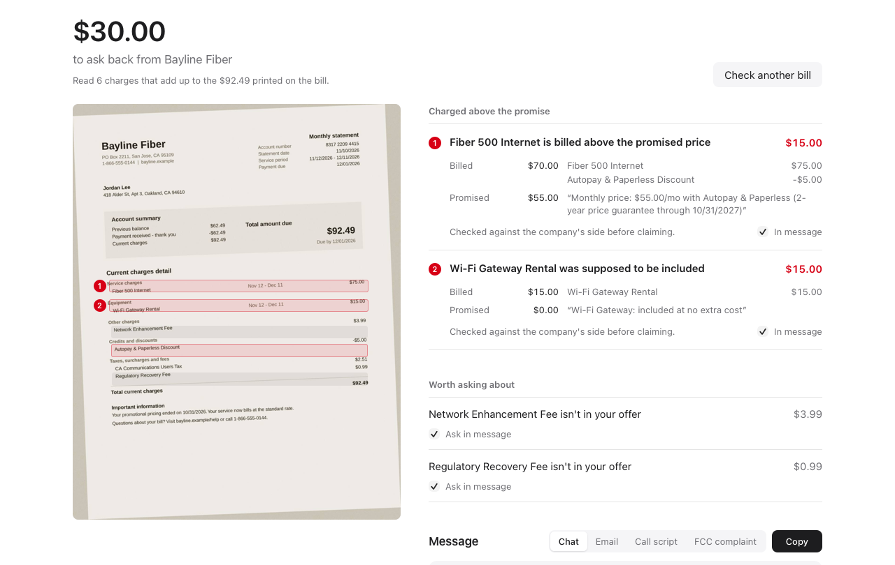

# Billproof

Billproof puts a phone, internet or utility bill on the stand against what the company promised, and drafts the message that gets the difference back.

Drop in the bill (PDF or a phone photo) and the promise: the offer email, a screenshot, or a recording of the sales call. Billproof marks each charge that breaks the promise on the bill itself, sets the printed line beside the offer's words (or the moment on the call where they were said), has Muse Ember argue the company's side before anything is claimed, and writes the dispute as a chat message, an email, a call script or an FCC complaint. Drop up to twelve months of bills and it reads the whole year at once and shows the month the promise broke (a year check skips arguing the company's side; see step 6). Built for the Meta Muse Ember hackathon: every check runs on `muse-ember-1.0` and costs a fraction of a cent.

Live: https://billproof.aktan.us (six samples run from the start screen, including two recorded calls and a year of bills).



The "Internet, price guaranteed" sample, a made-up bill, as the site shows it after a check.

## How a check works

1. The browser renders each PDF page to an image and keeps its text layer; photos are scaled to 1600 px; a recorded call is decoded to 16 kHz mono WAV. A bill PDF longer than six pages (an offer longer than four) is read from its first pages, where the charges are, and both the file and the result say how many were left out. Nothing is uploaded until you press Check. The server measures the recording from its bytes and refuses anything over four minutes.
2. Muse Ember reads the bill into structured line items (amount, kind, quote, position on the page) at high reasoning effort. Its reasoning summary and each line stream to the screen as they are read, and the lines light up on the bill. On a PDF, each mark sits on the printed row that carries the line's label, taken from the text layer, so a box the model places a row off still lands on the right line.
3. If the line items don't add up to the printed current charges, Muse Ember reads the bill once more at xhigh effort. Two readings that still disagree end the check with "could not check" rather than a guess.
4. Muse Ember reads the offer and links each promise to the bill lines it governs. A recording is sent as audio: Muse Ember writes the transcript (speaker, start time, words) and quotes each promise from it with the second it was said.
5. Code, not the model, decides every dollar:
   - a promise counts only if its quote is in the offer (or the transcript) and its amount is in the quote;
   - a bill line counts only if its quote is on the bill's text layer and carries its amount;
   - a promise that ended before the bill period is shown as explained, not claimed;
   - conditions like autopay need proof on the bill; paperless or bundle conditions can't be proven from a bill, so they become questions;
   - an offer from a different company, a promise that starts or ends mid-period, or an amount that looks misread becomes a question;
   - each bill line backs at most one claim;
   - a promise that something is included covers only a charge whose label it names, so a gateway promise linked to the internet plan by mistake claims nothing;
   - a claim resting on a photo or on a recording waits until the person confirms the marked line, or plays the clip and confirms what was said.
6. Muse Ember then argues the company's side of each claim: it searches the bill and the offer for a credit, an end date or a condition that would defeat it. A claim is dropped only when the rebuttal quotes the offer word for word, or quotes a credit on the bill that pays the claim back. The bill's own notices ("your promotional pricing ended") are the company's position, not proof, so they never drop a claim; an offer rebuttal that can't be found word for word leaves the claim standing for the person to confirm. A year check does not run this step: its months' claims come from the dollar rules alone, and the result shows "Checked against the company's side" only on claims that went through it.
7. The message is assembled from fixed sentences filled with verified fields, so every number in it traces to a claim you selected. Promises from a call are cited with their time in the recording.

Only three kinds of claim produce dollars: a price above a promised monthly price, a charge for something promised as included, and a promised recurring credit that is missing. Company fees nobody agreed to and charges listed twice are offered as questions to ask, never as overcharges.

With several bills, each is checked on its own, four at a time, and its result streams in as it lands. The year view counts each statement once, only for the account most of them belong to, and adds only the claims you keep selected.

Screenshots dropped together, up to six, are treated as one pile; a bigger pile is refused rather than cut short, since the picture left out could be the offer. Muse Ember first sorts each picture into bill, promise (a chat with the company, an offer, an email) or neither; the bill pages are read as the bill, and the promise pictures join whatever the person wrote as the offer. Promises read off screenshots always wait for the person to confirm.

Every message comes in four forms: a chat message, an email, a call script, and a complaint ready for the FCC (phone, internet, TV) or a state utility commission (electric, gas, water), with a blank for what the company said when asked. The company is asked to credit a claim or explain a fee, a repeated charge or a rise; the complaint states them as facts ("The bill charges the Network Enhancement Fee ($3.99) and Regulatory Recovery Fee ($0.99), which were not part of the plan I agreed to."), since a regulator can't remove a fee, and names the problem by what the claims are (a price above a promise, a charge for something included, a missing credit). When the bill doesn't name the company, the email is addressed to the billing team and the complaint leaves the company's name to fill in.

## Spend

Before each model call the server counts the exact input tokens with `POST /v1/responses/input_tokens` and reserves the worst case (all input uncached, every allowed output token) in a SQLite ledger. Reservations are checked against a per-check cap of 3¢ per bill and an event cap, then settled to the billed usage. A call lost mid-flight stays counted at its full reservation. When one bill of a year fails, no other bill starts a new paid call, and the failure is reported only after the calls already running have settled. The cost of each check, and the tokens of each model call, are shown under the result. A check starts only from Billproof's own page (the browser's `Sec-Fetch-Site: same-origin`, or a matching `Origin` from Safari before 16.4), so another site can't spend it from its visitors' browsers, and four run at once across the server.

The whole project, local runs and the live site together, is held under $10 of Meta spend. Local runs used $8.33, so the live server's event cap is $1.60 (`deploy/compose.yml`), a combined worst case of $9.93. Once the cap can't cover one more check, the start screen and the real-bills page say live checks are paused and the live-run button turns off; every saved result stays on the real-bills page. The site's robots.txt keeps crawlers off the "Check it live" links, which start a paid check when their page runs, and each address gets 30 checks an hour.

## Run it

```bash
pnpm install
MODEL_API_KEY=… pnpm dev
```

| Variable | Default | Meaning |
| --- | --- | --- |
| `MODEL_API_KEY` | required | Meta Model API key |
| `EVENT_BUDGET_MICROS` | `6000000` | Total spend the ledger allows, in millionths of a dollar |
| `LEDGER_PATH` | `data/ledger.db` | SQLite ledger file |

Checks: `pnpm typecheck`, `pnpm lint`, `pnpm test`.

Deploy: `deploy/compose.yml` runs the app behind Caddy on one server. On the server, run `deploy/deploy.sh`: it stops without changing anything if a check started in the last five minutes (`deploy/active-checks.mjs`; a rebuild replaces the container, which would cut that check off after its spend), appends the running app's log to `logs/app.log` (Docker deletes a container's log with it), pulls the repo and runs `docker compose -p billproof up -d --build` in `deploy/`. A change to `deploy/Caddyfile` also needs `docker compose -p billproof restart caddy`: Caddy reads its config through a bind mount of the file, and `git pull` replaces the file rather than editing it, so a reload alone still sees the old one. Validate a Caddyfile first with `caddy validate --adapter caddyfile`, since a bad one takes the site down.

## Evaluation

`pnpm eval` renders every synthetic bill in `scripts/samples/eval-specs.ts` as a PDF and as a phone photo, runs each through the real pipeline and Muse Ember, and scores claims, false claims, questions and explanations against the planted ground truth. The set includes clean lookalikes (promises honored, credits posted), an expired promotion, a promotion ending mid-cycle, an unproven autopay condition, an offer from another company, and an unsupported electricity rate plan. It also runs the same internet bill against two recorded calls (one promising two years, one only the first year) and a year of twelve statements where the price rises in month nine and a gateway fee appears in month eleven.

Run on 2026-11-26 on the code that is live, after every rule change below (`eval/run-2026-11-26.json` holds every event, reading and model call; the first full run, on 2026-11-25, scored the same and is in `eval/run-2026-11-25b.json`):

| Input | Checks completed | Claims found | False claims | Questions found | Explained |
| --- | --- | --- | --- | --- | --- |
| PDF | 12/12 | 5/5 | 0 | 9/9 | 2/2 |
| Phone photo | 12/12 | 5/5 | 0 | 9/9 | 2/2 |
| Recorded call | 2/2 | 2/2 | 0 | 4/4 | 2/2 |
| Year of 12 bills | 12/12 | 6/6 | 0 | 0/0 | 0/0 |

Median cost per single-bill check: 0.15¢, with the challenge step included. The year of twelve bills cost 2.1¢ and took 28 seconds. All 27 checks together: 69 paid Muse Ember calls (16 more steps reused an identical earlier reading), 229,354 input tokens (216,796 served from Meta's prompt cache), 124,475 output tokens including reasoning, $0.064. The bills and calls are synthetic (the calls are synthesized voices), so these numbers show the pipeline holds its rules; real bills and calls are messier.

`pnpm samples` regenerates the sample bills, the two recorded calls and the year of statements on the start screen.

## Real bills

The synthetic set proves the rules; the real-bills run shows what happens on the internet's actual mess. `pnpm census <posts.jsonl>` runs Billproof over public Reddit posts about phone, internet and TV bills, eight at a time, each post's pictures as one pile and its words as what the poster says they were promised. The results are on the site at `/real`, where any of them can be checked again live.

Run on 2026-11-25: about 181,000 posts from 32 subreddits (Xfinity, Spectrum, AT&T, Verizon, T-Mobile, Google Fi, Optimum, Cox, Starlink, DirecTV and others, back to 2019) were scanned through the Arctic Shift archive; 1,517 had pictures and talked about a promise, promo, credit or price change; the pictures of 1,251 were still online. Muse Ember sorted those pictures and found the real bills among chats, app screens and ads; the posts it read as bills were then checked again after the fixes below. 132 are real bills (seven more were counted as bills until the quote rules below: two AT&T sales quotes, a dealer's AT&T ad, a Spectrum order confirmation, an AT&T plan price list, a Starlink balance with no charges, and a T-Mobile summary a poster typed with a Reddit tool); 14 more showed a bill whose charges couldn't be read reliably, so they weren't checked, and the other 1,105 showed something other than a bill. 36 carry company fees the poster never mentions agreeing to, $481.20 a month in all, led by state "Cost Recovery" charges, "Broadcast TV" and "Regional Sports" fees. 107 of the bills print a total, an amount due or a subtotal for every part, and list their charges. On 94 of them, the charges Muse Ember read add up to them to the cent (71 to the printed current charges, 17 to the amount due once any unpaid balance is counted, 6 to each of their part subtotals); one more, a Spectrum post, adds up only because its order was read as the bill (see the listed-fee rule below), and is not counted; on 8 more, the first charges add up to a subtotal the bill prints before the rest; 4 don't add up, and in every one the pictures leave something out. Three are cut off before every charge shows (a Fios bill and two Google Fi bills whose taxes are below the edge), and a US Cellular post shows each phone line's charges but not the account-level fees: its summary prints $17.14 in fees and taxes, the two lines show $14.82, and the $2.32 between them is the gap. One post has a dollar claim, a credit missing against what the poster quoted, and it holds up when read by hand: a Verizon watch line missing its $7.50 discount, which Verizon later paid back. It waits for the poster to confirm the marked line, because a photo can't be checked against a text layer. Before this round's fixes there were eight posts with a claim and only one held up; a second, a Xumo box Spectrum said was included, looked right until the picture showed a $5 discount printed right under it. Every stored reading was then put through the final rules again without new model calls; the only changes were six lines no longer counted among the company's own fees (a "Video Franchise Fee", two combined "Taxes & fees" lines, a "WiFi Service", a "Return Payment Fee", and a one-cent T-Mobile line the bill prints under "Taxes & fees"). Bills rerun only to check their arithmetic were kept only when their findings came out the same. The first pass took 14 minutes and cost $0.93; the passes after the fixes, 10 minutes and $0.63; the last rerun of every bill, for the order-summary sign below, $0.44.

What the real posts taught it, each fix checked against the synthetic set (still 5/5 PDF, 5/5 photo, 2/2 call, 6/6 year, no false claims):

- Many posts show two months side by side. Billproof used to read both as one bill, doubling every fee. Now the sorting step marks earlier statements, the bill is read from the newest one only, and the earlier one is read just to list what moved ("Up $95.12 since the earlier bill: Internet $109.00 → $165.25, Ultimate TV $78.50 → $118.98, …"). The comparison is left out when either statement's charges miss its own printed total, since then part of it is cut off and lines would look gone, or new, that aren't. Twelve posts have one.
- Totals are recognized however the bill labels them ("Total monthly charges", "Bill total"), so far more bills can be checked against their own arithmetic: 110 of the 137 read as bills at the time instead of 47, and 107 of today's 132. A printed subtotal that the first charges add up to counts as a subtotal match, and charges that, with any unpaid balance, come to the printed amount due count as a match; neither sends the bill to be read a second time.
- A heading read as a charge ("Apple TV $3.00" over the lines that make it up) counted its lines twice. The reading rules now say to skip such headings, and when one slips through, code drops it, but only if that makes the bill add up to its printed total, so a charge that really is billed twice stays.
- A long bill that ran out of room on the first read is read again with twice the room instead of failing.
- A cropped screenshot with no dates no longer turns every promise into a "partial month" question; only promises with dates need the bill's dates.
- A free item can no longer be claimed against the plan's own price, and the company's name no longer counts as naming an item ("Spectrum Modem Included" is not about "Spectrum Internet").
- Read from a poster's own words, complaints, wishes and their own arithmetic are left out of the promises, and so are offers shown by someone shopping for a plan or advertising one.
- "About $20" is not a promise of $20, "for 12 mos." and "for a year" limit a promise in time, and a per-line credit isn't owed on a $0 line.
- A discount printed right under an included item for exactly its amount pays it back, even when it wasn't linked to the promise.
- A sales quote or order summary for a plan or device not yet started is not a bill, nor is a page that says what "will appear on" the first bill, while an invoice table for dated service periods and a preview of the next bill are; a line's label is its name alone, without its rate or quantity. An earlier page with no charges read is not compared against.
- On a picture, a line whose quote leaves out its amount still counts by its position on the page; a quote with a different amount still doesn't. Claims from pictures always wait for the person to confirm the marked line.
- On a pictured offer, a fee or tax the offer itself lists for exactly the amount a price is over drops that price claim, when the company-side check quotes it. A Spectrum bill rolled the $1.25 California Cost Recovery Charge its order lists into "Spectrum Internet $41.25", and a rerun claimed $1.25 above the $40 promise; with the rule and the check told to look for such a fee, two reruns kept only the true claim, $15 charged for home phone against the $10 promised, which is the poster's own complaint. The site keeps this post's earlier result because a live run of it still matched no promise, and that result is a misread: it took the order's 16 lines and its $172.15 monthly total for the bill, so it asks about the $1.25 fee but claims nothing, and it is named rather than counted among the bills that add up. No saved finding on the site changes under this rule: the only claim there is a missing credit, which the rule does not touch.
- Some bills print no overall total, only one per section or per person. Those part totals are now read too, and a bill whose charges split, in order, into runs that match every one of them counts as adding up. Part totals can nest ("Services & Equipment $58.00" over "Services $22.00" and "Equipment $36.00"), so a total that equals the totals printed right after it, or two or more printed right before it (a grand total after each line's total), is treated as their parent. Of 36 real bills rerun that had no usable total, 16 then added up and none failed to; the 13 whose findings came out the same are on the site.
- Only the company's own added fees are asked about. Franchise, PEG, 911, 988, Universal Service and sales-tax charges, combined "Taxes & fees" lines, services that aren't fees ("WiFi Service") and penalties for a returned or late payment are not, whatever kind the reading gave them; going over the label of every flagged fee on the real bills found four such lines, $36.52 a month, now left out. A promise written in the agreement the customer signed is not treated as conditional on a contract.
- A charge printed once for each person or phone line is not asked about as charged twice. When the bill's own part totals split its charges, copies that fall under different parts belong to different lines; the split may stop at the last part total (a home-phone section with no total of its own after four phone lines), and a grand total printed after its parts counts as their parent. On photos, copies on different pictures are not asked about either: they are separate tabs, or the same line pictured twice by overlapping screenshots (on a PDF, pages are one statement and still count). Applied without new model calls to the saved readings, these remove 14 such questions from five bills (a table of five AT&T lines' "Monthly charges" and "Company fees & surcharges" among them, and two Google Fi tabs) and change no bill's totals check. Four bills still ask about a repeated charge, and by eye one is a fair question (a Boost bill charging device protection for two back-to-back months) while three are the same plan on each of two phone lines (two T-Mobile bills and a US Cellular bill), printed on one picture with identical lines and no part totals that split them. Nothing printed tells those lines apart: one T-Mobile app list shows no phone numbers at all, the other T-Mobile bill prints one before each row but the poster scribbled them out, and on the US Cellular one the only marker is a crossed-out name above the second line's charges. They stay as questions rather than a rule that guesses from row order, which would also hide a real double charge. The real-bills page says why such a line is asked about ("Experience More AAL 3+, charged 2 times"). Reading every person's tab of one statement was also tried in the reading instructions; it read both Google Fi tabs in one of two runs, so it was not kept.
- A fee printed more than once is asked about once, with every copy and their total ("TV Access Fee isn't in your offer, charged 2 times", $14.00), and not again as a repeated charge. A live check showed a DIRECTV bill listing "TV Access Fee isn't in your offer" twice beside "TV Access Fee is charged 2 times"; on the saved bills, 19 per-copy fee questions merged into their fee and 3 repeat questions on fees were dropped, without changing the number of bills with fees or their monthly total.
- The message asks about every fee in one request, each with its amount ("Please explain the Broadcast TV Fee ($47.23), Regional Sports Fee ($19.86) and Regulatory Cost Recovery ($0.12)"), instead of the same sentence once per fee. With no dollar claim, the FCC complaint names the problem it raises (fees never agreed to, or charges unexplained) rather than "billed above the price I was promised", and the email and call ask for an explanation instead of the date a credit will post. A promise heard on a call is cited as "your representative" to the company and by the company's name to a regulator, and a year message quotes each promise once, then says "as quoted above".
- Two promises on the same lines (a price and its discount) raise a question about them once, not twice in the same words. A live check of six real posts, for 2.5¢, found a Spectrum bill saying "The end date of your offer for Spectrum Internet Gig couldn't be read" twice; the saved results had five such repeats on four bills, now one each. The six live checks otherwise matched their saved fees and totals (one Xfinity bill now also added up to its printed $165.56).
- A second live sample of five real posts matched its saved fees and totals on four. The fifth, a Fios app screen, read no charges in two live runs: it shows "Services, Equipment & Discounts $19.99 +" collapsed, with its lines hidden, and the reading drops it as a heading over lines it can't see. Telling the reading that a collapsed heading is itself one line fixed that bill in two runs out of two and kept the synthetic set perfect, but on the rerun of every real bill two AT&T bills whose tables give each phone line one row (monthly charges, fees and taxes in columns) lost their charges, $72.64 a month of fees, so it was not kept ($0.49 with the synthetic set). The sample also led to two wording fixes on the result page: a post that states no price is now headed "No price or promise found to check the bill against" instead of "Couldn't match your offer to this bill", and an offer condition the reading can't name reads "The bill doesn't show that you meet your offer's conditions".
- The unnamed-condition wording has not been seen live: across every saved run only four real posts ever raised that question, and live runs of three of them, for 1.1¢, raised other questions instead (their fees and totals matched). They did show "Read 1 charges that add up" on a one-charge bill, now "Read 1 charge that adds up". Rerunning that bill live after the fix made a false claim: an AT&T app screen with the plan at "$44.79/mo." beside a checkout cart for a new phone ("Due monthly $32.22", the phone's "$22.22 … for 36 mos. at 0% APR" and Next Up Anytime), and Billproof claimed the plan $12.57 above the cart's total. A price promise whose quote is a cart total or a device's financing ("Due monthly", "Due today", "add to cart", installments, financing, "% APR") is now left unused, with the reason shown. "Checkout" alone is not among those words: of the 83 real posts whose text has any of them near a dollar amount, posters use "checkout" about plan prices too ("expecting the total price to be $70 a month before tax, and the page prior to checkout said so", against a $90 bill), while "Due monthly" and the financing words describe only carts and phones. Requiring every price promise to name its line was not done, since it would also stop true claims from posters' own words ("I was told it would be $55 a month"). Re-applied without model calls to the saved readings of all 132 bills, no claim or question changes; across every saved promise of every kind, the words appear only in this phone's financing and its "OFFER APPLIED" line, "$46.60 for device installments" and a cart's "Total Due Monthly: $51.98/mo", none of them on a bill the site lists, and the synthetic offers have none.

The outcome check: the authors' own later comments on every real bill were read for whether the company paid them back. Four said it did for a charge Billproof checks. On the Xfinity bill the company credited, Billproof shows the $95.12 jump line by line; on the Verizon one it claims the missing $7.50 discount, the amount Verizon paid back. On the other two it found nothing, and both are misses. The Spectrum bill shows home phone at $15.00 against the $10.00 the poster's order promised, but both pictures, order included, were sorted as the bill, so the order's price was never read as a promise, and the poster's "$15 for Home Phone instead of $10" was not read as one either; the same poster's other post of the same bill is the misread Spectrum post above, where reruns now claim the $5.00. The Google Fi post pictures one statement as two people's tabs: one shows the $30.00 plan, a $20.80 Pixel bill credit and $2.93 in taxes, $12.13 in all; the other shows the same plan and taxes, $32.93, with no credit, which is the poster's complaint. Billproof read only the tab with the credit, so the one without it was never compared, and the poster quotes no amount promised for it in any case. The page lists all four.

The reading check by eye: seven real bills, six of them drawn at random, were compared with their pictures after the fixes (AT&T, two DIRECTV, Xfinity, Spectrum side by side with its earlier month, Visible, Verizon). All 45 lines were read with the right label and amount, and from the newest statement. A second random draw of ten more (two Spectrum, Xfinity, Visible, Boost, Starlink, Google Fi, Optimum, AT&T and one with no company name shown) found all 45 of their lines right too; one of the ten was an AT&T sales quote rather than a bill, which led to the quote rule above. A third draw, of ten bills with flagged fees, found all 25 flagged fees to be real company fees at the right amounts, none of them taxes, checked against the picture or, where the bill adds up, its own printed total (7 of the 10 add up to their total and 2 to a printed subtotal). The tenth printed its total only as the heading over its charges, which led to reading such a heading as the total when nothing else is printed: of 12 bills rerun that had no usable total, 4 then added up and none failed to. A fourth random draw of eight (Fios, AT&T, Optimum, Google Fi, T-Mobile and three with no company name shown) found all 24 lines right, checked against the picture or the bill's own total; the bills among them with no usable total are screenshots cut off before their total, or that print a total only for the taxes. A fifth draw of eight all add up to their own total or amount due. The seven bills that add up only to a printed subtotal were then compared with their pictures for the lines after it: all of them (taxes, government fees, a Spanish-language payment reversal and returned-payment charge) are on the bill at the amounts read. Of the 17 that add up to the amount due, only two count a balance carried over (a $231.25 Spectrum balance and a $97.84 Xtream balance credited back); both match their pictures, as do the three whose amount due was read from an unusual place (an app's "Internet $60.00" autopay card, an AT&T "Internet $75.24" heading, and an Xfinity Mobile statement of $8,028.21 that is almost all a roaming charge). The rest were then compared too, until every one of the 137 bills had been looked at beside its pictures and printed totals. Five were not bills (the dealer's ad, the order confirmation, the plan price list, the Starlink balance and the typed T-Mobile summary named above); the order-summary sign was added for them, and with it all five read as not bills on every rerun, three times each, while the other 132 stayed bills. Every charge on the 132 matches a picture at the amount read, but on one, a Spectrum post, the picture read is the order rather than the bill (see the listed-fee rule above), which a later scan of the saved readings of all 132 for printed charges that miss the amount due with nothing carried over found. That scan found no other; the rest it turned up print taxes after a subtotal, or are plan-price screens such as AT&T's "Current plan cost details", which the rule for account screens counts as bills. (Two of the 132, whose first picture has since been deleted, were matched to their saved readings by hand: a Google Fi statement cut off above its taxes, read from the newer of its two months, and an Xfinity bill whose one $95.00 charge is its printed monthly total.)

The Google Fi tab miss led to a scan for its kind. Of the 28 bills whose bill pages number two or more, 20 have a bill page with no line read; by eye, each unread page is another view of the same bill (an account summary, a past-due or payment-history screen, a discount list, a bill history, a chart, a plan page, or an order on the two Spectrum posts), and where people or phone lines are billed apart, the page read lists every one of them (a Google Fi group summary of $98.92, an AT&T table of each line's charges, $370.91 in all). The Google Fi post above is the only one whose unread page holds charges the reading left out.

The other direction was checked too: the 1,105 posts the first pass sorted as not bills were sorted again under the final rules, for $0.66. 32 then read as bills three times out of three, but by eye only four are statements or part of one (a Fios statement's discount page, an AT&T fee comparison, a device credit and a Spectrum service update); the rest are plan, balance, renewal and payment-history screens that the rule for account screens lets in. They are not added, and that rule is the known soft spot. A tighter rule was tried, under which a screen of monthly plan prices with no billing period, statement date or due date, or an estimate of the bill after a change, is not a bill: it sorted out 24 of those 33 screens, but also 18 of the 132 bills, among them Xfinity, Spectrum and T-Mobile statements checked by eye, so it was not kept (the try cost $0.50, the synthetic set included, which it passed). Seven more read as bills once and not on rerun; one of them is an AT&T plan-change estimate on which Billproof claimed an $18 discount was missing, and that claim is wrong, because the $57.60 price shown already includes it. A random ten of the not bills, and ten more whose titles talk about a bill or a charge, were also compared with their pictures: all twenty are chats, ads, plan pages, payment lists or other screens without a bill's charges, except a Spectrum service update that the final rules do read as a bill.

The real-bills page also runs live: one button checks 24 of these real bills at once, eight at a time, with every bill's reading, fees and cost streaming into a grid. Only the site's own page can start a run; one run goes at a time, six an hour across the site and one an hour per address.

Only public posts are used. The site shows each post's title and links to it; pictures are fetched from Reddit by post and position, never by an address the visitor supplies.

## Proof of usage

Every check returns its own trace: each Muse Ember step with its reasoning effort, input, cached and output tokens, and cost, shown under "How it was checked" on the result screen. The prompts are `SORT_INSTRUCTIONS`, `READ_BILL_INSTRUCTIONS`, `READ_TERMS_INSTRUCTIONS` and `CHALLENGE_INSTRUCTIONS` in `src/lib/pipeline.ts`; the evaluation trace is `eval/run-2026-11-25b.json` and the real-bills run is `src/data/real-bills.json`. The server ledger (`data/ledger.db`) records every reservation and settled cost.

## Privacy

Files and recordings go to Meta Model API with `store: false`. The server keeps no files; it holds the extracted readings in memory for 15 minutes so a retried check does not pay twice. A recording plays back from your own browser, never from the server.
